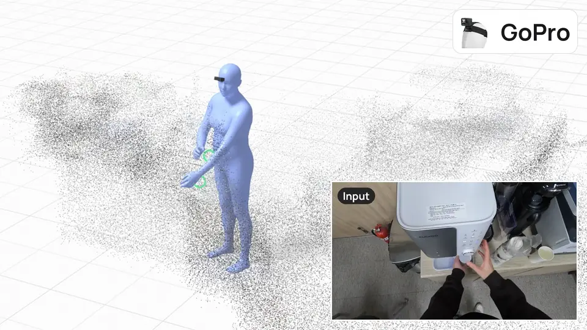

# OmniEgoCap: Device-Agnostic Sequence-Level Egocentric Motion Reconstruction (NeurIPS 2026)

## [🌐 Project Page](https://kyungwoncho.github.io/OmniEgoCap/) &nbsp;|&nbsp; [📜 Paper](https://arxiv.org/abs/2512.19283) &nbsp;|&nbsp; [🤗 OmniEgoDB](https://huggingface.co/datasets/cscandkswon/OmniEgoDB)



This is the official code for the NeurIPS 2026 paper "OmniEgoCap: Device-Agnostic Sequence-Level Egocentric Motion
Reconstruction".

## News

- [2026/10/19] Code and checkpoint are released.
- [2026/09/25] OmniEgoCap is accepted to NeurIPS 2026.

## Installation

Tested on Ubuntu 26.04 with an RTX 3090 Ti, CUDA 11.8, Python 3.11 and PyTorch 2.7.1.

```
git clone https://github.com/KyungWonCho/OmniEgoCap.git
cd OmniEgoCap

conda create -n omniegocap python=3.11 suitesparse
conda activate omniegocap
pip install torch==2.7.1+cu118 torchvision==0.22.1+cu118 --index-url https://download.pytorch.org/whl/cu118
pip install -r requirements.txt
pip install -e .
```

theseus is built from source with the CUDA 11.8 toolkit:

```
export CUDA_HOME=/usr/local/cuda-11.8
export PATH=$CUDA_HOME/bin:$PATH
export LD_LIBRARY_PATH=$CUDA_HOME/lib64:$LD_LIBRARY_PATH
pip install --no-build-isolation "git+https://github.com/facebookresearch/theseus.git"
```

## Download

**SMPL-H.** Download the "Extended SMPL+H model" from the [MANO website](https://mano.is.tue.mpg.de) and put
`SMPLH_NEUTRAL.npz` (and `SMPLH_MALE.npz`, `SMPLH_FEMALE.npz` for AMASS preprocessing) in `data/smplh/`.

**Checkpoint.** Download `omniegocap.pt` from [Google Drive](https://drive.google.com/file/d/1DqF8a-aKGl_wih1jwcqcaZO0k_-1zF7f/view?usp=sharing) to `checkpoints/`.

## Demo

From an Aria recording with its [MPS](https://facebookresearch.github.io/projectaria_tools/docs/ARK/mps) output:

```
python scripts/prepare_input.py aria_mps --vrs recording.vrs --mps_dir mps/ --output seq_input.npz
python scripts/sample.py --input seq_input.npz --output seq_smplh.npz
python scripts/visualize.py --input seq_input.npz --pred seq_smplh.npz --video recording.vrs
```

For other devices, `prepare_input.py trajectory` takes a camera trajectory and wrist poses from any hand estimator
(see `omniegocap/adapters/trajectory.py`).

## Preprocessing

Download AMASS (SMPL+H G) from the [AMASS website](https://amass.is.tue.mpg.de) and build the training and evaluation
sets from the splits in `data/amass/`:

```
python scripts/preprocess_amass.py --amass_dir /path/to/AMASS
```

This writes `train.h5` and the test sets of Tab. 1 (`test_diverse.h5`) and Tab. 2 (`test_fov90x90.h5`,
`test_fov120x120.h5`, `test_fov180x180.h5`, `test_fov120x60.h5`, `test_fov120x120_tilt30.h5`) to `data/preprocess/`.
`--sets train` builds only the training set, and `--camera H,V[,T]` adds a test set for another camera (field of view
in degrees, tilted T degrees down).

## Training

Single GPU:

```
python scripts/train.py
```

Multi GPU (e.g. 8 GPUs):

```
mpiexec -n 8 python scripts/train.py
```

## Evaluation

**AMASS.** Diverse Simulated Visibility (Tab. 1) is evaluated on `test_diverse.h5`:

```
python scripts/eval.py amass --h5 data/preprocess/test_diverse.h5
```

Generalization across Camera Setups (Tab. 2) is evaluated on each of its five test sets, for example:

```
python scripts/eval.py amass --h5 data/preprocess/test_fov120x60.h5
```

**OmniEgoDB.** Download [OmniEgoDB](https://huggingface.co/datasets/cscandkswon/OmniEgoDB) (log in to Hugging Face and accept the terms first):

```
hf download cscandkswon/OmniEgoDB --repo-type dataset --local-dir /path/to/OmniEgoDB
```

`--track` is one of `aria`, `aria_rgb`, `gopro` and `quest`.

```
python scripts/eval.py omniegodb --root /path/to/OmniEgoDB --track aria
python scripts/visualize.py --omniegodb /path/to/OmniEgoDB --track aria
```

## Citation

```bibtex
@inproceedings{cho2026omniegocap,
  title     = {OmniEgoCap: Device-Agnostic Sequence-Level Egocentric Motion Reconstruction},
  author    = {Cho, Kyungwon and Na, Jeonghyeon and Joo, Hanbyul},
  booktitle = {Advances in Neural Information Processing Systems (NeurIPS)},
  year      = {2026}
}
```

## Acknowledgements

We thank the authors of [guided-diffusion](https://github.com/openai/guided-diffusion),
[HuMoR](https://github.com/davrempe/humor) and [EgoAllo](https://github.com/brentyi/egoallo) for releasing their code.

## License

The code is released under the [MIT License](LICENSE), and the checkpoint under
[CC BY-NC 4.0](https://creativecommons.org/licenses/by-nc/4.0/). SMPL-H, MANO and
AMASS are under their own licenses. Third-party code is listed in `THIRD_PARTY_NOTICES.md`.
